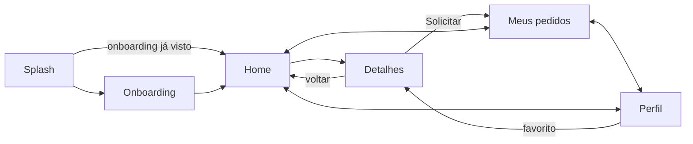
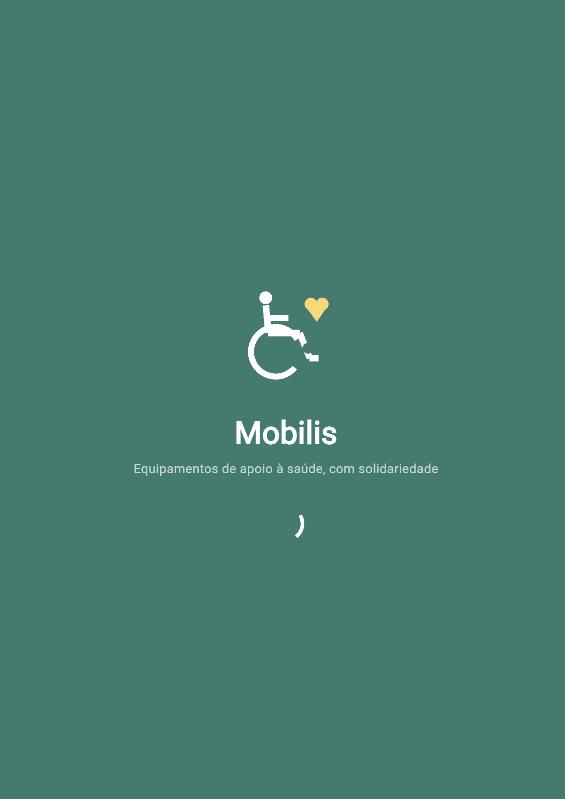
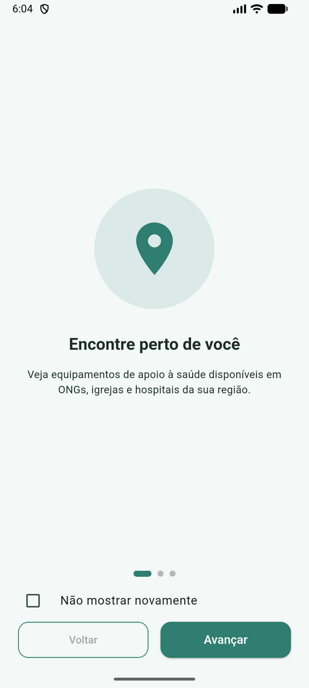
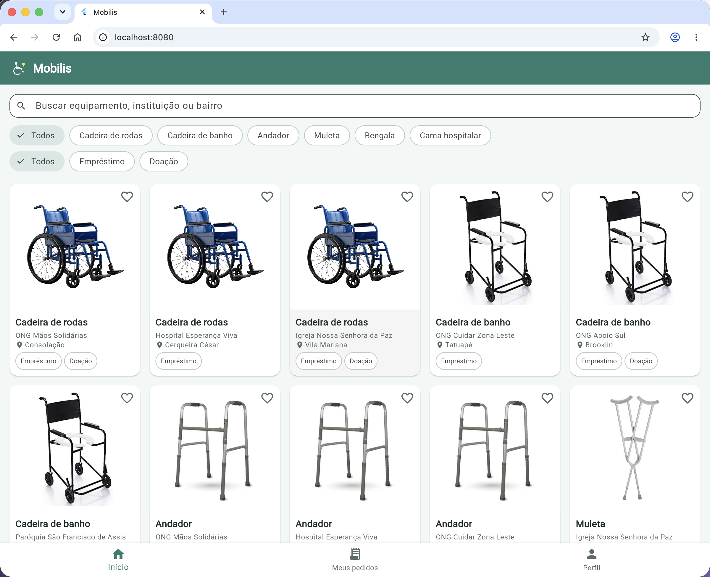
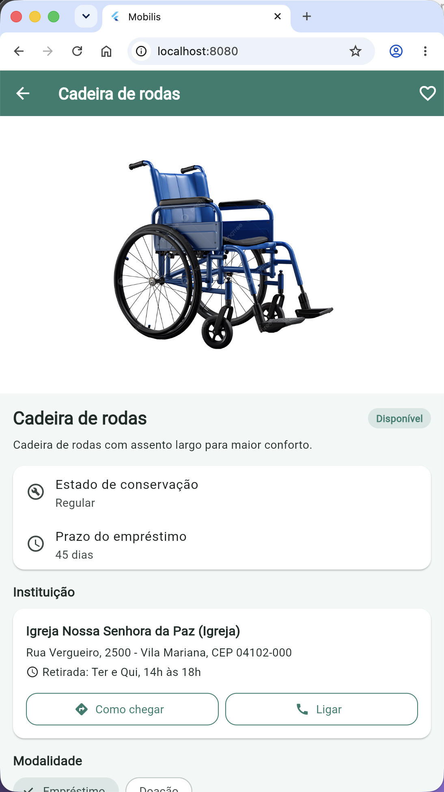
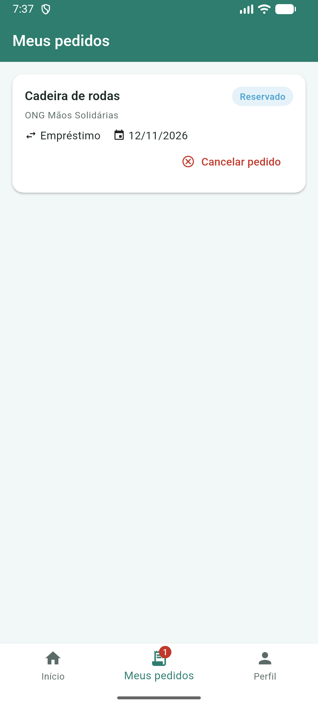
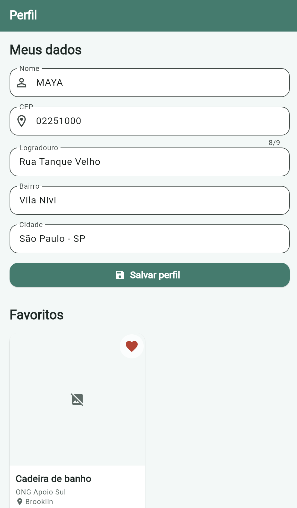

# Mobilis

Aplicativo Flutter do lado do **solicitante** de um banco solidário de equipamentos de apoio à saúde (cadeira de rodas, cadeira de banho, andador, muleta, bengala e cama hospitalar), cedidos sem custo por ONGs, igrejas e hospitais, por empréstimo ou doação.

## 1. Desenvolvedoras

- Mayara Santos Pereira Tavares – RM559031
- Mariana Pacheco Torres – RM558956
- Graziely Tavares da Silva – RM559111

## 2. Tema da Global Solution

**CitizenTech** (Global Solution 2026.2), alinhado aos ODS 3 (Saúde e Bem-Estar), 10 (Redução das Desigualdades) e 11 (Cidades e Comunidades Sustentáveis).

**Problema que o Mobilis resolve:** muitas pessoas precisam de equipamentos de apoio à saúde e não têm como comprá-los, enquanto instituições têm itens parados em estoque. O Mobilis aproxima as duas pontas: o cidadão encontra o equipamento disponível perto de casa e o solicita por empréstimo ou doação.

## 3. Descrição da solução

O solicitante abre o app, vê um breve onboarding e chega à tela inicial com os equipamentos disponíveis em São Paulo. Ele pode buscar por texto, filtrar por tipo de equipamento e por modalidade (empréstimo ou doação), favoritar itens e abrir os detalhes. Na tela de detalhes ele vê as informações do item e da instituição, o horário de retirada, traça a rota no Google Maps ("Como chegar"), liga para a instituição e solicita o equipamento na modalidade desejada. Os pedidos ficam em "Meus pedidos", onde podem ser cancelados. No perfil, o usuário informa nome e CEP (o endereço é preenchido pela API ViaCEP) e acompanha seus favoritos.

Os dados do usuário (onboarding visto, favoritos, pedidos e perfil) ficam salvos no próprio aparelho com `shared_preferences`.

## 4. Fluxo de telas



## 5. Prints das telas

| Splash | Onboarding | Home |
|:---:|:---:|:---:|
|  |  |  |

| Detalhes | Meus pedidos | Perfil |
|:---:|:---:|:---:|
|  |  |  |

## 6. API utilizada

### ViaCEP

- Endpoint: `GET https://viacep.com.br/ws/{cep}/json/`
- O app usa `logradouro`, `bairro`, `localidade` e `uf`. CEP inexistente retorna `{"erro": true}`, tratado como falha.

Exemplo de resposta (`/ws/01310100/json/`):

```json
{
  "cep": "01310-100",
  "logradouro": "Avenida Paulista",
  "complemento": "de 612 a 1510 - lado par",
  "bairro": "Bela Vista",
  "localidade": "São Paulo",
  "uf": "SP"
}
```

### JSON de equipamentos (GitHub)

- URL raw: <https://raw.githubusercontent.com/Maya-Tavares/mobilis-flutter/main/data/equipamentos.json>
- Lista com 18 equipamentos fictícios em São Paulo. Estrutura de cada item:

```json
{
  "id": 1,
  "tipo": "Cadeira de rodas",
  "descricao": "Cadeira de rodas dobrável em aço, com apoio de pés removível.",
  "estadoConservacao": "Bom",
  "modalidades": ["Empréstimo", "Doação"],
  "status": "Disponível",
  "fotoUrl": "https://picsum.photos/seed/mobilis1/600/400",
  "instituicao": {
    "nome": "ONG Mãos Solidárias",
    "tipo": "ONG",
    "endereco": "Rua Augusta, 1200",
    "bairro": "Consolação",
    "cep": "01304-001",
    "latitude": -23.5539,
    "longitude": -46.6527,
    "horarioRetirada": "Seg a Sex, 9h às 17h",
    "telefone": "(11) 3000-1001"
  },
  "prazoDiasEmprestimo": 60
}
```

Instituições, endereços e telefones são fictícios.

## 7. Arquitetura

```
lib/
├── main.dart            # ponto de entrada e MaterialApp
├── models/              # Equipamento, Instituicao, Endereco, Pedido, Perfil, EstadoRequisicao
├── services/            # EquipamentoService, CepService, PreferenciasService, FiltroEquipamentos
├── screens/             # Splash, Onboarding, MainShell, Home, Detalhe, MeusPedidos, Perfil
├── widgets/             # EquipamentoCard, StatusChip, EstadoCarregamento, BotaoPrimario, TelaBase
└── theme/               # cores, espaçamentos e ThemeData
assets/images/           # logo
data/equipamentos.json   # base de equipamentos consumida via URL raw
test/                    # testes unitários e de widget
```

- **Separação de camadas:** regras de negócio, acesso à rede e persistência ficam em `models` e `services`; as telas só montam a interface e chamam os serviços.
- **Estados de requisição:** o enum `EstadoRequisicao` (`inicial`, `carregando`, `sucesso`, `erro`) é exibido pelo widget `EstadoCarregamento`, com mensagem amigável e botão "Tentar novamente".
- **Persistência:** `shared_preferences` guarda a flag de onboarding, os ids favoritos, os pedidos e o perfil.
- **Gerenciamento de estado:** apenas `StatefulWidget` e `setState`, sem pacote externo. O `MainShell` guarda os dados compartilhados (equipamentos, favoritos e pedidos) e os repassa às abas por parâmetros e callbacks.
- **Widgets reutilizáveis:** `EquipamentoCard` (Home e favoritos), `StatusChip`, `EstadoCarregamento`, `BotaoPrimario` e `TelaBase`.
- **Pacotes:** `http`, `shared_preferences` e `url_launcher`.

## 8. Como executar

Requisitos: Flutter 3.41.7 (canal stable) com Dart ^3.11.

```bash
git clone https://github.com/Maya-Tavares/mobilis-flutter.git
cd mobilis-flutter
flutter pub get
flutter run            # escolha o dispositivo; use -d chrome para rodar no navegador
```

Testes e verificação:

```bash
flutter analyze
flutter test
flutter build apk --debug
```

O app precisa de internet para carregar os equipamentos e consultar o CEP.
